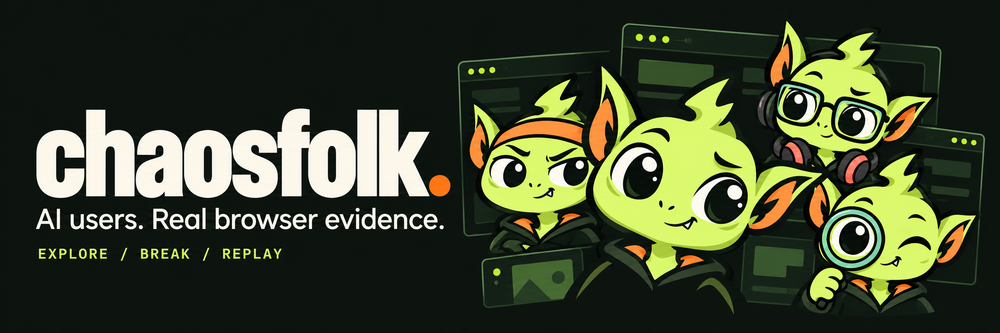
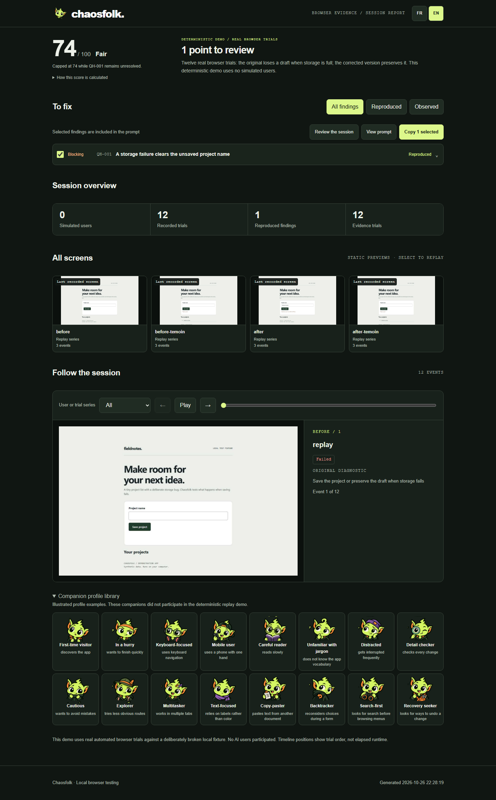
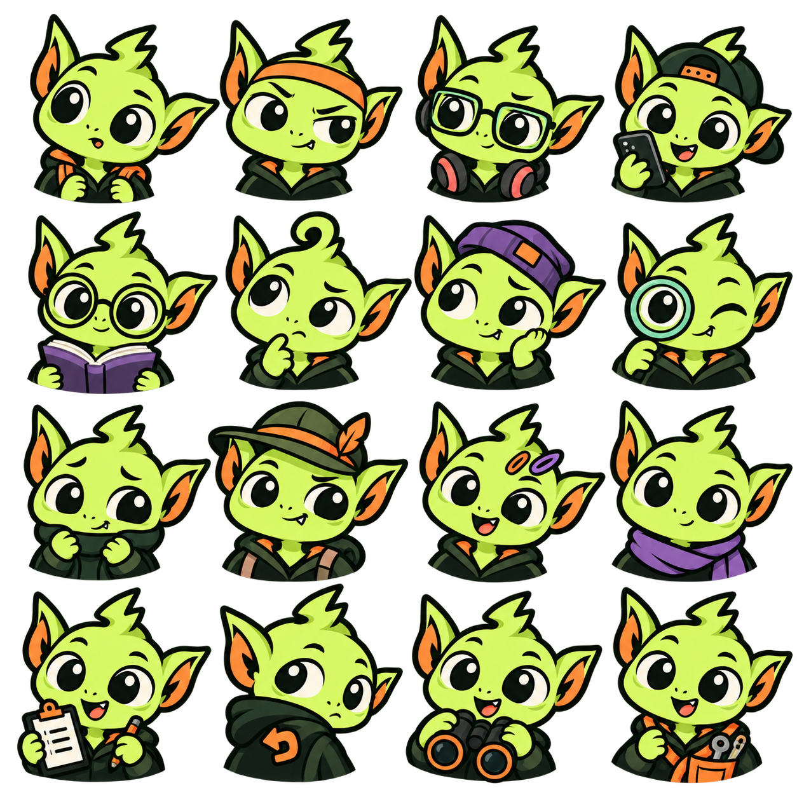

<div align="center">



# Chaosfolk

### Let a crowd of AI users loose on your app. Keep the evidence.

[](https://github.com/loukan42/chaosfolk/actions/workflows/tests.yml)
[](https://www.python.org/)
[](LICENSE)

[Try the demo](#try-it-without-an-ai-agent) · [Install the skill](#use-it-with-your-coding-agent) · [How it works](#from-an-observation-to-a-reproducible-bug) · [Contribute](CONTRIBUTING.md)

</div>

Your tests follow the paths you wrote. People double-click, lose their connection,
leave a form halfway through and come back in another tab.

Chaosfolk gives simulated users their own browser, goal and habits. Your coding
agent coordinates the exploration while the engine injects failures and records
what happened. Interesting failures become replayable scenarios with explicit
assertions, screenshots and control runs.

**A character saying “this is broken” is an observation. Three failing replays,
plus three passing controls, are evidence you can inspect.**

> Alpha software. Simulated users are fictional. Their reactions are useful test
> hypotheses; they are not research with real people or a measure of accessibility compliance.



The screenshot shows 12 real browser trials on the demo app and no simulated users.

## Give your coding agent a test mission

After installing the engine and skill below, paste this into your coding agent:

```text
Use Chaosfolk on my local test app. Explore the main user journeys with four
simulated users, using synthetic data. Do not send messages or make purchases.
Produce a report with screenshots and replay evidence; do not edit the app.
```

## Try it without an AI agent

Python 3.12+ and Git are required. Run these commands in your terminal:

```bash
git clone https://github.com/loukan42/chaosfolk.git
cd chaosfolk
python -m venv .venv
```

Activate the environment:

```bash
# macOS / Linux
source .venv/bin/activate
```

```powershell
# Windows PowerShell
.\.venv\Scripts\Activate.ps1
```

Then install and run:

```bash
python -m pip install .
python -m playwright install chromium
chaosfolk check
chaosfolk demo
```

Open `.horde/demo/rapport.html`. Keep the report beside its screenshot folders.
Use `chaosfolk demo --output .horde/another-demo` for another run.

The demo launches a local project-list app with a deliberate bug: the form
clears your draft before saving it. When storage is full, the save fails and
the draft disappears. Real Chromium trials compare the broken and corrected
versions, each with and without the fault. No model, API key or fabricated
user feedback is involved. The command succeeds only when the expected results
are measured, then shuts down its local server.

## Use it with your coding agent

Install the Python engine above, then install the skill:

```bash
npx skills add loukan42/chaosfolk --skill chaosfolk
```

The installer requires Node.js and npm and lets you choose your agent. If your host does not use this installer,
follow [manual installation](docs/agents.md). The skill needs a shell, file access
and subagents. Claude Code can use the optional dedicated user agent:

```bash
chaosfolk install-agent
```

Ask your agent:

```text
Use Chaosfolk on http://localhost:3000, my local test app.
Explore creating a project, finding it again and editing it.
Use 4 simulated users, 20 actions each, synthetic data only.
Do not send messages or make purchases. Produce a report; do not edit the app.
```

The catalog contains 16 behavior profiles. Each user can attempt all supplied goals in a seeded order. Start with four users. The expanded preset uses twelve users with forty actions
each. The action cap bounds browser work, not model tokens or elapsed time.
Your agent host supplies and bills the models; Chaosfolk has no built-in model
provider and sends no telemetry.

## From an observation to a reproducible bug

```text
Goals + seed → personas → browser exploration + faults
                                      ↓
                         observations + screenshots
                                      ↓
                         scenario + explicit assertion
                                      ↓
                       3 fault trials / 3 control trials
                                      ↓
                           evidence + local report
```

1. The coordinator identifies the app's goals, allowed actions and test environment.
2. A seeded draw selects distinct behavior profiles and faults. Each user gets an
   isolated browser context; the coordinator keeps fault details out of their sheet.
3. Users interact through screen text and browser actions. The engine records
   screenshots, failures and brief fictional reactions, with action and time budgets.
4. The coordinator extracts a candidate's steps and writes an assertion describing
   the behavior that should hold. Replays run without a model.
5. A fault-related issue is reproduced only when all three treatment trials fail
   and all three controls pass. Incomplete trials stay inconclusive.

A seed reproduces the **persona and fault draw**. AI exploration and external
server behavior can still vary. Replaying a trace requires the same app state and
an accessible target. Use sequential replay when trials share backend data.

If you authorize repairs, the agent works on a separate branch. It tests the fix,
removes it in an isolated working copy to check the failure returns, then reapplies
it. Product decisions remain questions for the owner.

## What you can test

Every tester gets a companion skin tied to its behavior profile. The impatient
one wears a headband; the detail checker carries a magnifying glass. Your seeded
draw keeps each user's identity consistent across the cast and action timeline.



| Capability | Included |
| --- | --- |
| User behaviors | Impatient, keyboard-focused, mobile, distracted, unfamiliar with jargon, and more |
| Browser actions | Forms, clicks, keyboard, navigation, tabs, dialogs, fixture uploads |
| Fault injection | Offline, latency, HTTP errors, lost responses, server unavailability, storage failures, clock shifts, viewport changes, cleared cookies |
| Evidence | Action log, screenshots, replay assertions, treatment/control results |
| Report | Findings, evidence counts, copyable fix prompts, session timeline |
| Integrations | CLI, agent skill, optional Claude Code user-agent definition |

The current exploration catalog focuses on UX and application behavior. This is
not a load generator, security scanner, native-mobile test runner or real-user study.
Clock and network faults approximate specific conditions; they do not reproduce
every real browser or network failure.

## CLI essentials

```bash
chaosfolk draw --count 4 --budget 20 --seed 42 --objectives "Create a project;Find a project" --folder .horde/run
chaosfolk launch --url http://localhost:3000 --folder .horde/run --budget 20
# Set CHAOSFOLK_LEADER_TOKEN to the token printed by launch before reserved commands.
chaosfolk humans .horde/run/personas.json
chaosfolk drawn-faults .horde/run/tirage.json
chaosfolk sheets --folder .horde/run --budget 20 --data "Synthetic project names" --forbidden "External actions"
chaosfolk h01 look
chaosfolk analyze --folder .horde/run
chaosfolk trace h01 --around 8 --folder .horde/run
chaosfolk stop --keep-app
chaosfolk replay .horde/run/scenarios/save.json --times 3 --with-control
chaosfolk report --folder .horde/run
chaosfolk stop-app --folder .horde/run
```

`draw` prepares profiles; your agent supplies the users. `extract` creates replay
files from recorded actions; a replay path in the example must exist first.
See the [workflow guide](docs/workflow.md), [replay format](docs/replay.md) and
[fault reference](docs/faults.md) for complete examples.

`replay --fail-on-bug` returns `0` when all assertions hold, `1` for a failed
assertion or repeatable blocked step, and `2` for incomplete trials. A fault
reproduction intentionally fails this check; use it to gate corrected behavior.

The English CLI and replay input coexist with established French keys in stored
traces, filenames and some engine diagnostics. [The format reference](docs/replay.md)
documents this compatibility boundary. Reports are available in English and French with `chaosfolk report --lang en` or `--lang fr`. Recorded reactions and screenshots stay unchanged.

## Local by default

Use local apps or explicitly authorized test environments with synthetic data.
The engine can launch an app command and perform writes through its UI. A hostname
does not tell it whether a target is production: scope is the operator's responsibility.

Session tokens, screenshots, browser state and journals stay on disk. `.horde/`
is ignored by this repository. Add it to the tested project's ignore rules too.
Only files inside a session's `uploads/` directory can be uploaded through user
commands. Reports make no external requests for fonts or scripts, but screenshots
may contain sensitive content. Review them before sharing.

Tokens separate engine roles; agents sharing an OS account can still read each
other's files. Use a disposable environment without secrets. See [SECURITY.md](SECURITY.md).

## Development

```bash
python -m pip install -e ".[dev]"
python -m pytest -m "not browser"
python -m pytest -m browser
python -m ruff check .
python -m build
```

Browser tests need Chromium installed. CI exercises Linux and Windows, checks the
wheel installation and runs the real demo. See [CONTRIBUTING.md](CONTRIBUTING.md)
for the testing contract and [the roadmap](docs/roadmap.md) for concrete next work.

MIT licensed. Built by [Lou Husson](https://github.com/loukan42).
