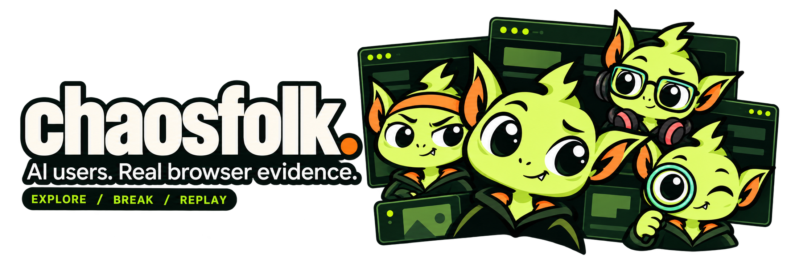
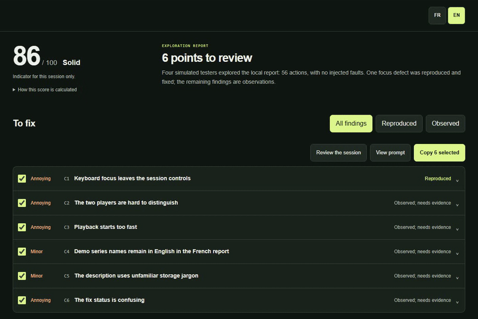
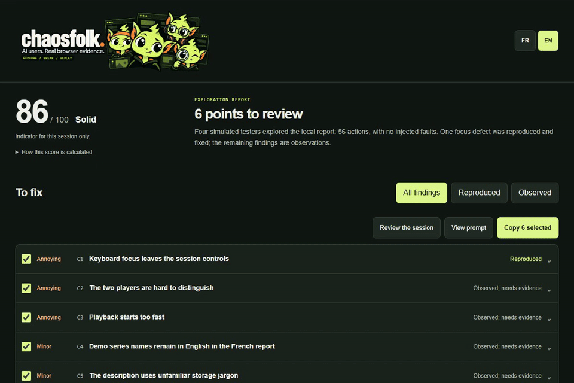

<div align="center">



**Simulated users break your web app in a real browser.<br>You get the bugs, the proof and a fix prompt for your coding agent.**

[](https://github.com/loukan42/chaosfolk/actions/workflows/tests.yml)
[](https://www.python.org/)
[](LICENSE)

[Why](#why) · [How](#how) · [What you get](#what-you-get) · [Install](#install) · [Try the demo](#try-the-demo) · [Use it on your app](#use-it-on-your-app)

</div>

### Watch the trailer

https://github.com/user-attachments/assets/500cdc82-94da-466b-bc26-2f85cfc8072d

## Why

Your tests check the paths you wrote. Your users take other paths. They
double-click Save, lose their connection halfway through a form, come back an
hour later in another tab. You rarely try these things yourself, because you
know how the app is supposed to work.

AI agents can explore an app for you, but "this looks broken" is an opinion.
You need to know whether the bug is real before you spend time on it.

Chaosfolk lets a small team test like a crowd of strangers, and only calls
something a bug when it can show it happening again.

## How

**Users with habits, in a real browser.** Your coding agent runs simulated
users, each with a goal and one of 16 behavior profiles: in a hurry,
keyboard-only, on mobile, distracted, unfamiliar with jargon. Each one drives
its own Chromium context and can work through several of your goals.

**Chaos on purpose.** While they work, the engine injects the conditions real
users meet: offline, slow or failing requests, lost responses, full or corrupted
storage, cleared cookies, clock jumps and viewport changes.

**Proof before verdict.** The agent turns each promising observation into a
scenario with an explicit assertion. The engine replays it without a model:
three failing trials with the fault and three passing controls without it mark a
finding as reproduced. Anything weaker stays labeled as an observation.

## What you get

A local HTML report, in English or French, built around what to fix.

### Findings, evidence and a fix prompt

A score out of 100, the findings with their severity, and the evidence behind
each one: replay results, screenshots and the expected behavior. Tick the
findings you want fixed and copy a ready-made prompt for your coding agent.



### Synchronized session replay

Watch every tester's screen on one timeline, change the speed and jump straight
to the moments where something went wrong.



Both recordings come from Chaosfolk auditing its own report with four simulated
users. The score is a [documented heuristic](docs/scoring.md) for one session,
not a measure of total coverage.

## Install

Chaosfolk has two parts: the **engine**, a Python program that drives the
browsers, and the **skill**, which teaches your coding agent how to use it.
Install both once; they work in every project.

Quick install of the skill, with [npx](https://nodejs.org/) and the
[Skills CLI](https://github.com/vercel-labs/skills):

```bash
npx skills add loukan42/chaosfolk --skill chaosfolk -g
```

The engine is installed separately in step 1. Step 2 below explains how to
pick your agent.

### Before you start

Open a terminal and check these three commands. Each one should print a version.

```bash
python --version
node --version
git --version
```

| You need | Version | If it is missing |
| --- | --- | --- |
| Python | 3.12 or newer | [python.org/downloads](https://www.python.org/downloads/). On Windows, tick "Add python.exe to PATH". |
| Node.js | 22.20 or newer | [nodejs.org](https://nodejs.org/), LTS version |
| Git | any | [git-scm.com/downloads](https://git-scm.com/downloads) |

On macOS and Linux, type `python3` wherever this guide says `python`.

### Step 1: install the engine

Install `pipx`, a tool that installs Python programs so they work from any folder:

```bash
python -m pip install --user pipx
python -m pipx ensurepath
```

**Close your terminal and open a new one**, then install Chaosfolk and its
browser:

```bash
pipx install git+https://github.com/loukan42/chaosfolk.git
chaosfolk install-browser
chaosfolk check
```

`check` prints one line per requirement. Every line should end with `OK`,
except the `chaosfolk-user` line, which only matters for Claude Code (step 3).

### Step 2: add the skill to your coding agent

Run the line for your agent. `-g` installs the skill for all your projects.

| Agent | Command |
| --- | --- |
| Claude Code | `npx skills add loukan42/chaosfolk --skill chaosfolk -g -a claude-code` |
| Codex | `npx skills add loukan42/chaosfolk --skill chaosfolk -g -a codex` |
| Cursor | `npx skills add loukan42/chaosfolk --skill chaosfolk -g -a cursor` |
| GitHub Copilot | `npx skills add loukan42/chaosfolk --skill chaosfolk -g -a github-copilot` |
| Gemini CLI | `npx skills add loukan42/chaosfolk --skill chaosfolk -g -a gemini-cli` |
| OpenCode | `npx skills add loukan42/chaosfolk --skill chaosfolk -g -a opencode` |
| Windsurf | `npx skills add loukan42/chaosfolk --skill chaosfolk -g -a windsurf` |
| Another agent | `npx skills add loukan42/chaosfolk --skill chaosfolk -g`, then pick it from the list |

The installer is the [Skills CLI](https://github.com/vercel-labs/skills), which
supports [over 70 agents](https://github.com/vercel-labs/skills/blob/main/docs/agents.md).
Answer `y` if `npx` asks to download it. Then **restart your agent** or open a
new session so it finds the skill.

### Step 3: Claude Code only

```bash
chaosfolk install-agent
```

This adds the simulated user definition, which runs testers on a cheaper model
and limits their tools. Restart Claude Code afterwards.

### Check that it works

Ask your agent: `Run chaosfolk check and tell me if anything is missing.` If it
answers with the same `OK` lines, you are ready.

Chaosfolk works best when your agent can start subagents, so testers run in
parallel. Without subagents, the agent plays them one after another: the run
takes longer and the testers are less independent.

<details>
<summary>Something went wrong?</summary>

- **`chaosfolk: command not found`**: open a new terminal. If it still fails,
  run `python -m pipx ensurepath` again, then open another new terminal.
- **`pip` refuses with "externally managed environment"** (some Linux and
  Homebrew setups): install pipx with your package manager instead, for example
  `brew install pipx` or `sudo apt install pipx`.
- **`npx: command not found`** or a Node.js version error: install the LTS
  version from [nodejs.org](https://nodejs.org/), then open a new terminal.
- **`chaosfolk check` shows a missing browser**: run `chaosfolk install-browser`
  again. On Linux, `chaosfolk install-browser --with-deps` also installs the
  system libraries Chromium needs.
- **Your agent does not know Chaosfolk**: restart it, or check that you used
  the `-a` value of the agent you actually use. `npx skills list -g` shows what
  is installed.
- **You prefer [uv](https://docs.astral.sh/uv/)**: `uv tool install git+https://github.com/loukan42/chaosfolk.git`
  replaces the `pipx` steps.
- **Manual installation**, or details for each agent: see the
  [agent guide](docs/agents.md).

</details>

To update later, run `pipx upgrade chaosfolk` and `npx skills update -g`.

## Try the demo

No AI agent or API key needed. The demo starts a small local app with a
deliberate bug: a form that loses your draft when storage is full. It runs real
browser trials on the broken and fixed versions, then writes the report.

```bash
chaosfolk demo --lang en
```

Open `.horde/demo/rapport.html` in the folder where you ran the command, and
keep it next to its screenshot folders. Use `--lang fr` for French; the report
has a language switch.

## Use it on your app

Start your app locally, open your coding agent in its project, and ask:

```text
Use Chaosfolk on my local test app at http://localhost:3000.
Explore creating, finding and editing a project. Use the medium run size,
synthetic data and an English report. Do not send messages or make purchases.
Report what you find without changing the app.
```

**Pick what to test.** Name one or more themes, or ask for `all`:
`functional`, `ux`, `accessibility`, `resilience`, `security`, `performance`,
`compatibility`. The report shows which themes were tested, partly tested or
left out.

**Pick a run size.** Preview one with `chaosfolk plan --level medium`.

| Run size | Simulated users | Actions per user |
| --- | ---: | ---: |
| Low | 2 | 12 |
| Medium | 4 | 20 |
| High | 12 | 40 |

These cap browser actions, not tokens. Model cost depends on your agent host,
your pages and the analysis; check it there.

## Limits

Chaosfolk is alpha software and its users are fictional: their reactions are
test hypotheses, not research with real people. Security checks are passive,
performance probes are small local smoke tests, accessibility checks are not a
conformance audit, and mobile means browser emulation. Use dedicated tools and
real devices to go deeper.

Run it only on local apps or test environments you are allowed to test, with
synthetic data. Screenshots can contain sensitive content, so review them before
sharing. See [SECURITY.md](SECURITY.md).

---

[Workflow and coverage](docs/workflow.md) · [Fault injection](docs/faults.md) ·
[Replay format](docs/replay.md) · [Contributing](CONTRIBUTING.md) · [MIT license](LICENSE)
