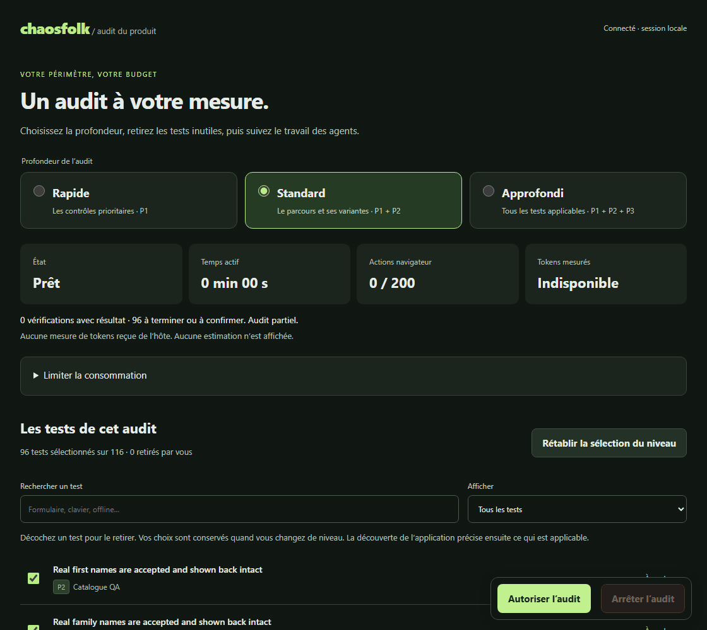

# Choisir jusqu'où Chaosfolk vérifie ton application

À paraître dans la prochaine version. [Read in English](product-audit-scans.md).

Tu peux choisir la profondeur du scan, retirer les tests inutiles et suivre
l'audit dans un tableau de bord local pendant que ton assistant de code l'exécute.

## Choisir la profondeur du scan

Le mode Rapide commence par les vérifications les plus prioritaires. Standard
ajoute davantage de cas autour des parcours de tes utilisateurs. Approfondi
sélectionne tous les tests du catalogue. Les trois modes portent sur l'ensemble
du produit, avec des tests adaptés aux fonctions découvertes dans ton application.

Par exemple, les tests d'ajout de fichiers s'appliquent lorsqu'un champ le permet.
Si une vérification exige un compte de test que tu n'as pas fourni, elle reste
visible avec le statut « bloqué ».

Tu peux décocher un test avant ou pendant le scan. Chaosfolk conserve tes choix
quand tu changes de niveau ou que tu reviens au tableau de bord. Un test retiré
ne reçoit plus de nouvelles actions ; une action déjà en cours peut se terminer.

[Voir une image fixe](../../assets/audit-scan.png). L'enregistrement montre les
réglages avant le démarrage d'un scan.

## Fixer des limites et suivre l'avancement

Le tableau de bord affiche le temps écoulé et l'état des tests. Tu peux limiter
la durée du scan ou le nombre d'actions dans le navigateur, comme les clics et
les saisies dans un formulaire. Le bouton Arrêter bloque les nouvelles actions
et interrompt les outils de test surveillés par Chaosfolk.

La consommation d'IA s'affiche quand ton assistant de code fournit cette mesure.
Les tokens sont les morceaux de texte traités par l'IA ; leur nombre aide à
suivre cette consommation. Si l'information manque, le tableau de bord indique
« indisponible ». Une limite de tokens exige des mesures récentes et complètes
pour poursuivre les tests.

Une demande déjà envoyée à l'IA peut encore consommer des tokens après l'arrêt.
Son annulation dépend de l'outil qui exécute les agents.

Le bouton Arrêter reste accessible pendant une sauvegarde et en bas de la liste
des tests. Un démarrage retardé par le réseau ne peut plus relancer un audit que
tu viens d'arrêter. Si une sauvegarde échoue, tes limites restent dans le formulaire,
même après rechargement. Deux onglets peuvent modifier des limites différentes
sans remplacer les choix de l'autre.

Tu peux aussi limiter le nombre de navigateurs d'utilisateurs ouverts en même
temps : six par défaut. Chaosfolk ferme ceux des utilisateurs qui ont terminé
avant d'ouvrir le lot suivant. Il conserve ceux qui servent à vérifier un parcours
à plusieurs utilisateurs, jusqu'à la fin de ces vérifications.

Si tu arrêtes puis reprends l'audit, les outils interrompus reviennent dans la
liste des tests à faire. Les observations déjà recueillies sont conservées.
Le bouton « Fermer le tableau de bord » ferme son serveur local ; pour arrêter
les tests, utilise le bouton Arrêter. Sans activité, ce serveur se ferme au bout
de quinze minutes.

## Savoir ce qui a été vérifié

Le rapport distingue les tests terminés, les observations à confirmer et le
travail inachevé. Tu retrouves aussi les tests que tu as retirés. Si un agent
termine son lot sans donner de résultat pour un test, ce test reste à faire.

Un scan Approfondi peut rester partiel si le temps manque, si une fonction est
inaccessible ou si un outil nécessaire n'est pas disponible. Pour annoncer le
scan terminé, chaque test sélectionné et applicable doit avoir un résultat
enregistré sur les parties du produit qui ont été découvertes.

Tant qu'aucun test n'a de résultat, le rapport n'affiche pas de note chiffrée.
La note reste indiquée comme provisoire si l'audit est incomplet. Les découvertes
menées en même temps conservent désormais toutes les pages enregistrées.

La copie anonymisée du rapport conserve le niveau choisi, les tests retirés et
leur état d'avancement. Les fichiers privés de session ont des droits d'accès
restreints. Les programmes de test externes sont fermés avec leurs sous-processus,
y compris quand le test se termine normalement.
Les copies à partager retirent aussi les messages détaillés de rejeu qui peuvent
contenir des valeurs saisies. Ces messages restent dans la session privée.
Les outils de sonde et d'accessibilité refusent de suivre une redirection :
il faut leur fournir l'adresse finale autorisée pour poursuivre le contrôle.

L'actualisation du tableau de bord ne fait aucun appel à l'IA. Les agents
reçoivent de petits lots de tests et des bilans courts pour limiter les
informations répétées dans leurs conversations.

Les commandes et l'installation sont décrites dans le
[guide des audits complets](../audit-runs.md).
